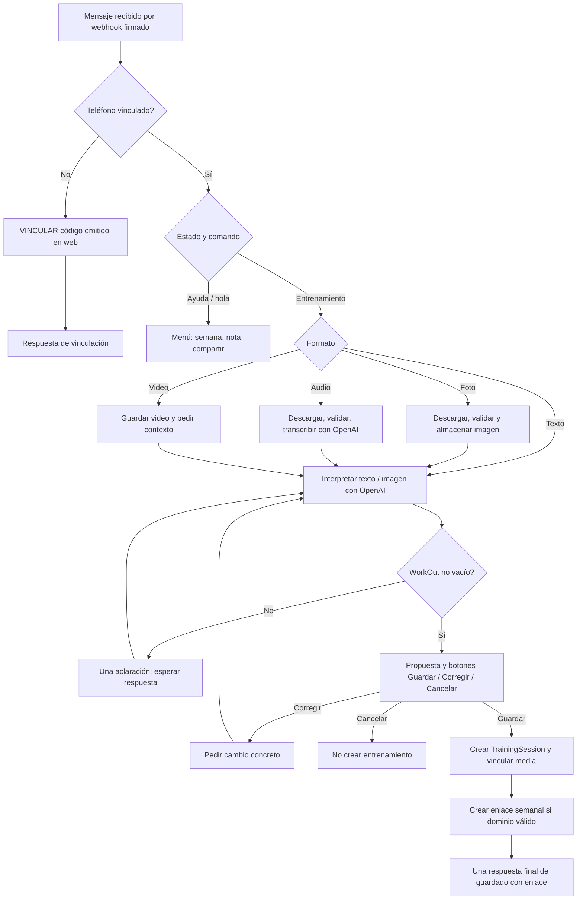

# Fluxio Movement: interacciones y costos de WhatsApp

Fecha: 9 de octubre de 2026, America/Santiago. Diagnóstico de solo lectura del código funcional; no se implementan recomendaciones en esta entrega.

## 1. Alcance, evidencia y conclusión

Se inspeccionó el **workspace actual**, que incluye cambios locales posteriores a `main`: menú con botones, nuevos textos y enlace semanal automático. Que una función exista aquí no prueba que esté desplegada en producción. El último commit publicado durante esta conversación fue `97583b5` (STOH). La aplicación de análisis en localhost:8000 y el Sandbox WhatsApp en localhost:8001 usan bases de datos distintas.

**Un entrenamiento completo de un atleta ya vinculado requiere normalmente 2 mensajes del atleta + 2 respuestas de Fluxio = 4 mensajes individuales y 2 ciclos conversacionales.** Con la tarifa aportada por el usuario y confirmada por su soporte, US$0,02 por respuesta saliente entregada o leída, cuesta **US$0,04 por registro**, sin OpenAI ni infraestructura. Audio mantiene esos mismos mensajes, pero suma una llamada de transcripción. No hay una llamada a IA por cada mensaje.

Las cifras son rutas exitosas modeladas, no promedios estadísticos. Asumen mensajes cortos, ausencia de fallos y entrega de todas las respuestas. Se distinguen botones pulsados, mensajes individuales, eventos técnicos y llamadas externas.

Fuentes principales: [capture.py](../app/whatsapp/capture.py), [runtime.py](../app/whatsapp/runtime.py), [identity.py](../app/whatsapp/identity.py), [media.py](../app/whatsapp/media.py), [queue.py](../app/whatsapp/queue.py), [worker.py](../app/whatsapp/worker.py), [Kapso provider](../app/whatsapp/kapso.py), [TrainingService](../app/services/training_service.py), [contratos](../app/services/training_contracts.py), [interpretación](../app/services/workout_interpretation.py), [transcripción](../app/services/training_transcription.py) y [resumen semanal](../app/services/weekly_summary.py).

## 2. Mapa del flujo actual



### Inicio e identificación

- No hay saludo proactivo obligatorio. El atleta vinculado puede enviar directamente su entrenamiento. `runtime.handle` resuelve el teléfono mediante `IdentityResolver.resolve`: hash del teléfono, identidad activa y atleta asociado; la información sensible se cifra.
- Un nuevo atleta necesita una cuenta web, autenticarse y generar un challenge con `IdentityResolver.issue`, luego enviar `VINCULAR <código>`. El código dura 10 minutos y tiene límites de uso/intentos. La vinculación consume un ciclo WhatsApp y no llama a OpenAI. Crear cuenta/login/challenge web no son mensajes WhatsApp.
- Enviar primero un entrenamiento sin vincular produce una respuesta de instrucciones; **ese entrenamiento no se registra ni queda como borrador que se retome automáticamente**. Hay que vincularse y reenviarlo.
- Activar/autorizase en el Sandbox de Kapso es distinto de vincularse a Fluxio. Los mensajes de activación del proveedor no los genera este repositorio y no se cuantifican sin su evidencia.

### Información indispensable y opcional

`SessionPayload` requiere fecha, título y `workout` no vacío. El sistema asigna por defecto la fecha actual de Santiago; reconoce ayer/hoy y fechas explícitas en español con `stated_date`. Un título vacío interpretado se sustituye por «Entrenamiento». Resultado, cargas/adaptaciones, RPE, bloques, imagen y vínculos de video no obligan a hacer otra pregunta. RPE solo se extrae cuando es explícito, entre 1 y 10; no se inventan resultados ni Rx.

Si el WOD es suficiente, `interpret` pasa directamente a propuesta. Las preguntas opcionales del modelo (máximo 8 en el esquema) se presentan **en esa misma propuesta**: no son ocho turnos obligatorios. Si `workout` está vacío, se envía solo la primera pregunta del modelo, o una pregunta genérica de ejercicios/series/rondas. Cada aclaración puede generar una nueva interpretación y otra pregunta: no hay máximo conversacional explícito de aclaraciones.

### Confirmación y cierre

Guardar es obligatorio en el flujo actual: el borrador no se persiste como entrenamiento confirmado antes del clic o del texto «guardar». Corregir y cancelar son opcionales. `TrainingService.create(commit=False)` crea el registro en la transacción del worker; se vincula la media, se limpia el estado y se encola la respuesta final. `saved_week_link` agrega el enlace de la semana del entrenamiento a **la misma respuesta**, sin otra llamada de IA. Crea un nuevo `WeeklyShare` por guardado, también de notas, cuando la base pública es válida; si no lo es, agrega un aviso en el mismo mensaje. Los enlaces son públicos, revocables, vivos y expiran hasta en 168 horas.

### Limitaciones verificadas

1. **Foto + texto en el mismo envío:** `KapsoWhatsAppProvider.normalize` toma `message.text.body`, pero no `image.caption`. La imagen sí llega; el caption no se incorpora a `source`. Por tanto, no está implementado el aprovechamiento de foto + contexto personal en un único mensaje de imagen. Texto e imagen ya almacenada sí pueden combinarse en una corrección posterior.
2. **Corrección posterior al guardado:** WhatsApp no tiene comando para editar el WOD o el resultado de una sesión existente. `Corregir` opera sobre la propuesta pendiente. `TrainingService.update` existe para web/API, pero no está invocado desde este flujo de WhatsApp. Sí se pueden añadir notas.
3. **Agregar nota:** acepta `nota <contenido>` directamente y propone guardar en el entrenamiento más reciente de los últimos 7 días. Si hay 2–3 candidatos del día más reciente, pide elegir uno; si hay más de 3 deriva a web. El botón de ayuda envía «nota», pide el contenido y deja el estado en `IDLE`; una respuesta libre sin prefijo **no está garantizada como nota**. Puede recibir instrucciones genéricas o entrar como entrenamiento. Hace falta repetir `nota <contenido>`; esto es una fricción funcional, no una pregunta de IA.
4. **Video:** descarga y guarda MP4 y pide texto/audio de contexto. No dispara el análisis biomecánico desde WhatsApp. No equivale al flujo web de análisis de movimiento.
5. **Texto reconocido:** en `IDLE` hay una expresión regular de vocabulario de entrenamiento antes de llamar a IA. Un entrenamiento válido escrito con vocabulario no cubierto puede recibir instrucciones en vez de una propuesta.

## 3. Secuencia de un registro completo

```mermaid
sequenceDiagram
    participant A as Atleta
    participant K as Kapso / WhatsApp
    participant B as Backend + worker
    participant O as OpenAI directo
    participant D as PostgreSQL + archivos
    A->>K: Texto, foto o audio
    K->>B: POST webhook firmado
    B->>D: Inbox deduplicado; identidad y estado
    opt Foto o audio
        B->>K: Descargar media
        B->>D: Imagen privada o temporales de audio
    end
    opt Audio
        B->>O: Transcripción
        O-->>B: Texto
    end
    B->>O: Interpretación estructurada texto / imagen
    O-->>B: Borrador y preguntas opcionales
    B->>D: Usage IA, estado CONFIRM, outbox
    B->>K: Propuesta + botones
    K-->>A: Respuesta 1
    A->>K: Guardar
    K->>B: Acción firmada con token de propuesta
    B->>D: Sesión + media + enlace semanal + outbox
    B->>K: Guardado + enlace semanal
    K-->>A: Respuesta 2
    K->>B: Delivered / Read
    B->>D: Actualizar estado de entrega
```

Un botón pulsado es un mensaje entrante del atleta. Los callbacks de estado, descargas de media y HTTP 200 del webhook no son mensajes de conversación. `READ` después de `DELIVERED` corresponde a la misma respuesta, **no a dos cargos de US$0,02** bajo la regla indicada por soporte.

## 4. Interacciones por escenario

I = interpretación estructurada; T = transcripción. «Salientes» presupone una propuesta en un solo mensaje. Un ciclo = envío del atleta y respuesta de Fluxio; los fragmentos adicionales no crean un nuevo ciclo.

| Escenario / ruta | Atleta | Fluxio | Total individual | Ciclos | OpenAI nominal | Salientes potencialmente facturables | Sandbox USD |
|---|---:|---:|---:|---:|---|---:|---:|
| A. Nuevo, vinculación válida + primer texto completo | 3 | 3 | 6 | 3 | 1 I | 3 | 0,06 |
| A2. Envía WOD sin vincular, luego vincula y reenvía | 4 | 4 | 8 | 4 | 1 I | 4 | 0,08 |
| B. Vinculado, texto completo + Guardar | 2 | 2 | 4 | 2 | 1 I | 2 | 0,04 |
| C. Foto legible suficiente + Guardar | 2 | 2 | 4 | 2 | 1 I multimodal | 2 | 0,04 |
| C2. Foto insuficiente + una aclaración + Guardar | 3 | 3 | 6 | 3 | 2 I, con imagen disponible | 3 | 0,06 |
| D. Audio suficiente + Guardar | 2 | 2 | 4 | 2 | 1 T + 1 I | 2 | 0,04 |
| E. Texto incompleto + una aclaración + Guardar | 3 | 3 | 6 | 3 | 2 I | 3 | 0,06 |
| F. N entrenamientos completos en la semana | 2N | 2N | 4N | 2N | N I; +N T si todos audio | 2N | 0,04N |
| G1. Corregir borrador: envío, Corregir, cambio, Guardar | 4 | 4 | 8 | 4 | 2 I; +T si entrada audio | 4 | 0,08 |
| G2. Editar entrenamiento ya guardado por WhatsApp | — | — | — | — | No implementado | — | No estimable como función existente |
| G3. Añadir nota completa a único candidato, confirmar | 2 | 2 | 4 | 2 | 0 | 2 | 0,04 adicional |
| G4. Nota completa, elegir entre 2–3 candidatos, confirmar | 3 | 3 | 6 | 3 | 0 | 3 | 0,06 adicional |
| Extra: ayuda / ver semana / compartir / revocar | 1 | 1 | 2 | 1 | 0 | 1 | 0,02 cada acción |
| Extra: video + texto de contexto + Guardar | 3 | 3 | 6 | 3 | 1 I | 3 | 0,06 |

Para un E con `k` aclaraciones: atleta = salientes = ciclos = `2+k`; OpenAI = `1+k` I si cada aclaración llega a interpretar; costo = `0,04+0,02k`. Si no pasa el filtro inicial, se suma un ciclo de instrucciones con 0 IA. Saludar y pedir ayuda antes de registrar agrega US$0,02 por respuesta, pero no es obligatorio.

### Operaciones de almacenamiento

Se cuentan **operaciones lógicas**, no número exacto de sentencias SQL/commits; `report_usage`, descargas y worker realizan commits intermedios y hay múltiples lecturas de permisos. No debe inferirse un costo de base de datos por mensaje sin medir proveedor/carga.

| Ruta | Persistencia de negocio / media | Persistencia conversacional y de consumo |
|---|---|---|
| B: texto base | 1 inserción TrainingSession; 0 archivos; 1 WeeklyShare si dominio válido | 2 inbox de usuario + 2 outbox; actualizaciones de estado; 1 TrainingAIUsage; hasta 2 eventos inbound y 2 outbound, más callbacks técnicos |
| A nuevo | Todo B + challenge web, verificación/consumo del challenge y AthleteIdentity; inicialización de estado | 3 inbox de usuario + 3 outbox; 1 I; onboarding una sola vez |
| C: foto | Todo B + 1 TrainingImage, archivo privado normalizado y 1 WhatsAppMedia; actualización de asociación al guardar | Media bytes/download y uso media; 1 I multimodal |
| D: audio | 1 TrainingSession y share; archivos temporales eliminados; **no audio durable ni WhatsAppMedia de audio** | 1 T + 1 I registrados en TrainingAIUsage; eventos de descarga; transporte como B |
| E una aclaración | 1 TrainingSession/share al final; dos interpretaciones, no dos entrenamientos | 3 inbox de usuario + 3 outbox; más estados CLARIFY/CONFIRM y 2 registros I |
| F N | N TrainingSession; hasta N nuevos WeeklyShare aunque sea la misma semana | N veces el costo lógico de B/C/D; resumen no se envía automáticamente aparte |
| G1 corregir borrador | 1 TrainingSession final; no sesión antes de confirmar | 4 inbox + 4 outbox; 2 I; estados CORRECT/CONFIRM |
| G3/G4 nota existente | Actualización de una TrainingSession (nota tipada), nuevo share si válido; no nueva sesión | 2/3 inbox + 2/3 outbox; 0 IA; posible SELECT_NOTE |

Si se cancela o abandona, no se crea sesión; pueden quedar uso IA, inbox/outbox, propuesta cifrada y media provisional. `worker.cleanup` vence payloads y media no asociada aproximadamente a las 24 h. Los datos de consumo sin contenido permanecen.

## 5. Costos del sandbox y proyección mensual

**Premisa contractual de esta estimación:** US$0,02 por respuesta saliente entregada o leída, suministrada por el usuario como confirmación de soporte. No se verificó una factura. No se aplica ese precio a cada mensaje entrante ni a cada llamada OpenAI. Un envío `SENT` aún no prueba entrega; uno `FAILED` no cumple la condición aportada. No se asume gratis todo error si el proveedor llegó a entregar antes de un resultado incierto.

Mes normalizado = 52/12 = **4,3333 semanas**, no 4 semanas. Moneda USD, sin impuestos, descuentos, créditos iniciales, cuota fija ni servicios externos. Se redondea al final, a centavos.

`C_registro = salientes_entregados × 0,02`

`C_semana = entrenamientos_semana × C_registro`

`C_mes = C_semana × 52/12`

### Atleta: 3, 4 y 5 entrenamientos por semana

| Modalidad repetida | USD/registro | Semana 3 | Semana 4 | Semana 5 | Mes 3 | Mes 4 | Mes 5 |
|---|---:|---:|---:|---:|---:|---:|---:|
| B / C suficiente / D / F, 2 salientes | 0,04 | 0,12 | 0,16 | 0,20 | 0,52 | 0,69 | 0,87 |
| E / C2, 1 aclaración, 3 salientes | 0,06 | 0,18 | 0,24 | 0,30 | 0,78 | 1,04 | 1,30 |
| G1, corrección de cada borrador, 4 salientes | 0,08 | 0,24 | 0,32 | 0,40 | 1,04 | 1,39 | 1,73 |
| A, primer período tras vinculación | primer registro 0,06 | 0,14 | 0,18 | 0,22 | 0,54 | 0,71 | 0,89 |
| A2, primer intento sin vincular | primer registro 0,08 | 0,16 | 0,20 | 0,24 | 0,56 | 0,73 | 0,91 |
| B + G3: todos reciben nota posterior, 4 salientes combinados | 0,08 | 0,24 | 0,32 | 0,40 | 1,04 | 1,39 | 1,73 |
| B + G4: nota ambigua posterior, 5 salientes combinados | 0,10 | 0,30 | 0,40 | 0,50 | 1,30 | 1,73 | 2,17 |

A y A2 agregan respectivamente US$0,02 y US$0,04 **una sola vez** al período; no se repite onboarding por entrenamiento. G2 no tiene proyección porque no está implementado. G3/G4 solos cuestan como una operación adicional, no sustituyen el registro base.

### Cohortes: costo mensual según número de salientes por registro

| Salientes por registro | Entrenamientos/semana | 100 atletas | 500 atletas | 1.000 atletas |
|---:|---:|---:|---:|---:|
| 2, base B/C/D/F | 3 | 52,00 | 260,00 | 520,00 |
| 2 | 4 | 69,33 | 346,67 | 693,33 |
| 2 | 5 | 86,67 | 433,33 | 866,67 |
| 3, E/C2 | 3 | 78,00 | 390,00 | 780,00 |
| 3 | 4 | 104,00 | 520,00 | 1.040,00 |
| 3 | 5 | 130,00 | 650,00 | 1.300,00 |
| 4, G1 o B+G3 | 3 | 104,00 | 520,00 | 1.040,00 |
| 4 | 4 | 138,67 | 693,33 | 1.386,67 |
| 4 | 5 | 173,33 | 866,67 | 1.733,33 |
| 5, B+G4 | 3 | 130,00 | 650,00 | 1.300,00 |
| 5 | 4 | 173,33 | 866,67 | 1.733,33 |
| 5 | 5 | 216,67 | 1.083,33 | 2.166,67 |

Para A, sumar US$2/10/20 a la fila base de 100/500/1.000 nuevos atletas; para A2, sumar US$4/20/40. Se calcula desde cifras no redondeadas, no multiplicando el valor mensual por atleta ya redondeado.

Una consulta semanal extra cuesta `0,02 × 52/12 = 0,0867` USD/atleta/mes. Una consulta por cada registro añade 50% al costo base de WhatsApp. Mezcla real: `C_mes = atletas × sesiones_semana × 52/12 × 0,02 × promedio_salientes_por_registro + onboarding + extras`.

### Fragmentación: costo oculto

`queue.reply` permite 1.024 caracteres con botones y 4.096 sin botones. Al superar el límite, divide en fragmentos de 1.000 caracteres y pone botones solo en el último. Una propuesta de 2.500 caracteres produce 3 respuestas salientes, no una; más el guardado = 4 salientes = US$0,08 aunque el usuario solo haga 2 ciclos. Una confirmación con enlace superior a 4.096 también se fragmenta. Debe medirse longitud y cantidad de outbox, no solo llamadas a `respond`.

## 6. OpenAI, producción e infraestructura: costos separados

### OpenAI directo

`workout_interpretation.interpret` llama una vez a `/v1/responses` mediante `ai_reasoning._request`; no hay bucle de retry en ese cliente. Modelo: `TRAINING_AI_MODEL` o `AI_REASONING_MODEL`, fallback configurado `gpt-5.6-terra`; imagen con detalle high. `training_transcription.transcribe` realiza una llamada a `/v1/audio/transcriptions`, modelo configurado o fallback `gpt-transcribe`. Ambos nombres son valores del código, no una afirmación de tarifa o disponibilidad comercial actual.

Texto/foto base: 1 I; audio: 1 T + 1 I. Guardar, ayuda, notas, vinculación y resumen/compartir no usan OpenAI. Cada aclaración interpretada o corrección del borrador suma I; si se responde con otro audio, también suma T. El worker puede repetir llamadas tras fallos, y el audio no tiene cache durable por inbox como la imagen. El presupuesto de 4.500 tokens de salida no es consumo real.

No se asigna costo monetario OpenAI: faltan precios verificables por modelo efectivo, tokens por modalidad, distribución de longitudes y descuentos. Calcular por intento real: `(tokens_entrada × tarifa_entrada + tokens_salida × tarifa_salida)/1.000.000`; audio según la unidad facturada por el modelo efectivo. No volver a sumar reasoning_tokens si ya están incluidos en output_tokens. Los tokens multimodales deben tratarse según su uso reportado, sin agregar un OCR separado inexistente.

### Producción con número real

**US$0,02 de este documento pertenece al Sandbox confirmado por soporte; no es una tarifa universal de producción.** La página oficial consultada publica Pro a US$25/mes con 100.000 mensajes y US$0,002 por excedente; define mensajes del plan como enviados **y recibidos**. Meta se cobra aparte según mercado, categoría y reglas vigentes, y se traslada sin margen. No confundir cupo/plataforma con cargo de entrega del Sandbox. [Kapso Pricing](https://kapso.com/pricing), consultado 09/10/2026.

Ejemplo de capacidad, no cotización total: 1.000 atletas × 5 sesiones × 52/12 × 4 mensajes individuales ≈ 86.667 mensajes/mes para el flujo base, antes de onboarding, errores y extras. En el plan Pro publicado cabría en el cupo; **US$25 sería solo plataforma**, no WhatsApp total. Falta confirmar contrato de Fluxio, país de destino, ventana/categoría y tarifa Meta efectiva. No asumir que las respuestas de servicio en producción son gratuitas ni extrapolar tablas antiguas. La guía vinculada por Kapso no pudo recuperarse en esta consulta; no se adjudica una tarifa Meta concreta.

Infraestructura adicional: backend/worker, PostgreSQL, almacenamiento de imágenes/video, egress/descargas, FFmpeg y túnel de pruebas. OpenAI usa claves del backend; no se invocan los agentes/transcripción IA de Kapso en este flujo. No se valoran servicios incluidos en planes que el código no utiliza. Abrir el enlace semanal genera tráfico web, no mensajes salientes ni llamadas IA.

## 7. Contraste con pruebas y ejecución real

Consulta agregada de solo lectura al Sandbox realizada el 09/10/2026, sin mostrar contenido, nombres, teléfonos, claves ni tokens:

| Métrica | Evidencia |
|---|---:|
| Inbox DONE, incluyendo eventos de estado | 156 |
| Eventos de consumo inbound de usuario | 46 |
| Outbox READ | 43 |
| Outbox FAILED | 3 |
| Eventos de consumo outbound | 43 |
| Descargas media / registros de uso media | 8 / 8 |
| Interpretaciones COMPLETED | 22 |
| Tokens I agregados entrada / salida | 36.713 / 10.028 |
| Transcripciones COMPLETED / segundos | 3 / 27 |

Los 43 READ representan respuestas distintas; a US$0,02 serían **US$0,86 de costo sandbox modelado**, no factura verificada. No sumarlos otra vez como delivered. Todos los `WhatsAppUsage.cost` consultados eran NULL: **desconocido, no cero**. Audio tenía tokens NULL, aunque duración registrada. Las cifras mezclan ayuda, vinculación, errores, registros y correcciones; no se pueden dividir entre sesiones para afirmar un costo real por WOD sin correlación por journey.

Se reprodujo en esta conversación `HTTP 402 / insufficient_credits`: el webhook y el worker procesaron mensajes, pero el proveedor rechazó el envío por saldo insuficiente. No era fallo del botón ni prueba de cargo entregado. Los reintentos manuales se rechazaron igualmente; no se lee ni publica payload personal para este análisis.

Pruebas inspeccionadas (no reejecutadas para este diagnóstico):

- [test_whatsapp_capture.py](../tests/test_whatsapp_capture.py): `test_text_confirm_exact_draft_double_action_and_duplicate`, `test_text_asks_one_clarification`, `test_optional_questions_propose_without_auto_save_and_correction_keeps_source`, `test_ogg_opus_real_decode_transcribe_interpret_confirm`, `test_photo_private_valid_and_cleanup`, `test_note_ambiguous_selection_and_foreign_athlete_protected`, `test_long_proposal_delivery_order_limit_and_uncertain_hold`, `test_worker_failure_rolls_back_then_replays_without_lost_or_duplicate_save` y `test_save_returns_public_week_once_for_saved_date`.
- [test_whatsapp_foundation.py](../tests/test_whatsapp_foundation.py): identidad, dedupe, errores de proveedor, reintentos seguros y estados sin regresión.
- [whatsapp_helpers.py](../tests/whatsapp_helpers.py): proveedor simulado; muchas pruebas sustituyen interpretación/transcripción, por lo que no son evidencia de cobros de OpenAI/Kapso.
- [KAPSO_SANDBOX_VALIDATION.md](whatsapp/KAPSO_SANDBOX_VALIDATION.md): evidencia histórica de foto, audio y confirmación real; el código posterior no debe atribuirse retroactivamente a esas ejecuciones.

## 8. Errores, reintentos y mensajes innecesarios

- Firma incorrecta, tamaño excesivo o canal mal configurado: rechazo HTTP; normalmente ninguna respuesta WhatsApp ni llamada IA. El proveedor puede reenviar webhook; `queue.accept` deduplica por ID/evento.
- Contenido desconocido, código inválido, token viejo, propuesta caducada, mensaje fuera de orden o petición mientras espera confirmación: una respuesta extra, normalmente sin IA; US$0,02 si se entrega.
- Media inválida/transcripción fallida/interpretación fallida: una respuesta de recuperación; puede haber descarga y llamada IA ya consumidas sin sesión final. Un fallo antes de invocar OpenAI no cuenta como llamada.
- Inbox procesado con excepción inesperada: hasta 3 intentos de worker, con espera de 30 s. No implica 3 respuestas facturables; puede repetir IA si se interrumpe después de consumirla.
- Outbound HTTP 429: retry seguro hasta 5 intentos con backoff; 402 queda FAILED. Fallo de envío incierto/5xx se conserva UNCERTAIN y no se reenvía a ciegas. Intentos no equivalen a mensajes entregados.
- Duplicar webhook no crea registro ni respuesta adicional por sí solo. Pulsar un botón viejo con un nuevo ID entrante sí puede provocar una respuesta de acción inválida.
- La confirmación final ya incluye el enlace: no agregar un segundo mensaje para compartir. Generar enlaces nuevos en cada guardado añade filas y superficie pública, aunque no aumenta mensajes si no se fragmenta.
- Opcionales no deben transformarse en cuestionario. Copiar todo el WOD, todas las preguntas y toda la explicación de privacidad puede fragmentar y duplicar el costo del camino feliz.

## 9. Flujo optimizado propuesto (todavía no implementado)

### Primera opción: conservar revisión explícita, reducir extras

1. Atleta envía texto completo o foto con caption: fecha si difiere de hoy, programación, resultado y RPE solo si quiere. Mostrar ejemplo breve en web/menú, sin saludo recurrente.
2. Extraer caption en el adaptador. Una interpretación conjunta, sin OCR separado ni volver a pedir el resultado que ya venía adjunto.
3. Si falta programación indispensable, una pregunta concreta o agrupada; ofrecer continuar en web si la lectura sigue fallando. No preguntar obligatoriamente por resultado, Rx, RPE o adaptaciones.
4. Una propuesta compacta <1.024 caracteres: nombre, fecha, resultado y puntos indispensables; botones Guardar/Corregir/Cancelar. El detalle largo se revisa en web.
5. Una respuesta final corta de guardado con acceso semanal. No enviar saludo, aviso «procesando» ni mensaje separado de enlace salvo latencia excepcional y necesidad probada.
6. Corregir campos tipados por botones cuando sea inequívoco (fecha/RPE/resultado), sin una nueva interpretación completa en todos los casos. Mantener IA cuando el cambio afecta la programación ambigua.

El camino completo actual ya logra 2 ciclos. Los ahorros de esta opción vienen de evitar fragmentos, capturas repetidas y correcciones, no de fingir que todos los registros tienen más turnos.

### Segunda opción: guardado directo con consentimiento (decisión de producto)

Para texto completo inequívoco, una preferencia explícita puede autorizar guardar en un ciclo y devolver una sola confirmación con Editar/Deshacer y enlace. **No existe actualmente**. Requiere política de certeza, idempotencia, borrado/reversión, consentimiento y tratamiento de imágenes ambiguas; no aplicar por defecto a fotos con datos de varias personas ni a resultados inferidos. Si el atleta requiere revisión previa, conservar primera opción.

| Ruta | Actual: salientes / I | Optimizada propuesta | Costo actual → propuesto | Ahorro |
|---|---|---|---|---|
| Texto completo con revisión | 2 / 1 | 2 / 1 | 0,04 → 0,04 | 0%; ya eficiente |
| Foto suficiente | 2 / 1 | 2 / 1 | 0,04 → 0,04 | 0%; mejorar calidad |
| Foto + caption hoy perdido, luego Corregir | 4 / 2 | 2 / 1 si caption suficiente | 0,08 → 0,04 | 50%, condicionado |
| Propuesta de 2.500 caracteres | 4 / 1 | 2 / 1 compactando | 0,08 → 0,04 | 50% |
| Texto completo con opt-in de guardado directo | 2 / 1 | 1 / 1 | 0,04 → 0,02 | 50%; nuevo producto |
| Audio completo con opt-in | 2 / 1 I +1 T | 1 / 1 I +1 T | 0,04 → 0,02 | 50% WhatsApp, IA sin cambio |
| Una aclaración indispensable, revisión explícita | 3 / 2 | 3 / 2 | 0,06 → 0,06 | No eliminar una pregunta necesaria |

Con guardado directo elegible: 3/4/5 entrenamientos por semana cuestan US$0,06/0,08/0,10 semanales y US$0,26/0,35/0,43 mensuales por atleta. Cohortes de 100: US$26/34,67/43,33; 500: US$130/173,33/216,67; 1.000: US$260/346,67/433,33. Solo WhatsApp, sin onboarding/extras. Si la elegibilidad es `p`, costo medio base propuesto = `0,04 − 0,02p`, no US$0,02 para todos.

## 10. Recomendaciones priorizadas

| Prioridad | Recomendación | Razón / indicador |
|---|---|---|
| P0 | Resolver saldo y clasificar 402 en telemetría sin guardar respuesta sensible | Sin entrega, la experiencia se detiene; alertar saldo bajo y error de facturación |
| P0 | Corregir estado de Agregar nota y preservar borradores al mostrar ayuda | Evita respuestas libres mal dirigidas y loops; éxito al segundo mensaje |
| P0 | Incorporar caption de foto y probar cuerpo+caption | Menos datos perdidos; reducción de correcciones y llamadas I |
| P1 | Medir journey por registro y facturación por outbox único delivered/read | No sumar callbacks ni contar SENT como entrega; correlación ausente hoy |
| P1 | Compactar propuestas/confirmaciones; separar detalle en web | P95 de longitud y fragmentos; objetivo habitual una propuesta y un cierre |
| P1 | Mantener preguntas opcionales en propuesta, no forzar RPE/resultado | Preserva costo base y evita inventar información |
| P1 | Distinguir enlace privado a Bitácora de publicación automática y reutilizar acceso válido | Menos tokens públicos; consentimiento y dominio utilizable, sin cambiar privacidad implícitamente |
| P1 | Correcciones deterministas para campos simples y cache idempotente de IA/audio | Menos I/T repetidas y costo de intentos interrumpidos |
| P2 | Evaluar opt-in de guardado directo con métricas de exactitud y deshacer | 50% máximo de ahorro WhatsApp del camino base; validar riesgo de registros incorrectos |
| P2 | Cotizar producción con país, categorías, cuota y contrato actuales | No escalar el precio sandbox como si fuera el costo del número real |

Métricas mínimas sugeridas: inbound de usuario, outbox único, fragmentos, delivered/read, intentos fallidos, ciclos hasta guardar, abandono, aclaraciones, correcciones, modalidad, I/T con modelo y uso, tiempo hasta respuesta y sesiones creadas exactamente una vez. No registrar teléfono ni contenido de entrenamiento en métricas. Conservar `UNKNOWN` para uso/costo faltante.

**Decisión para revisión:** priorizar caption, estado de notas, observabilidad de saldo y propuestas compactas; conservar confirmación explícita inicialmente. Evaluar guardado directo como fase posterior. Ninguna recomendación ha sido implementada por este análisis.
