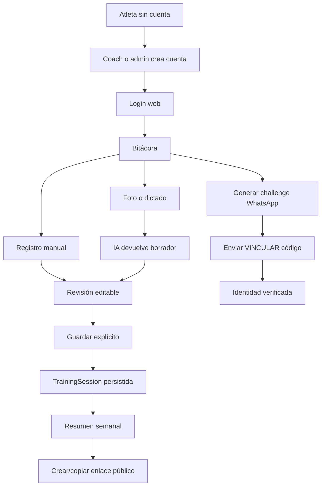
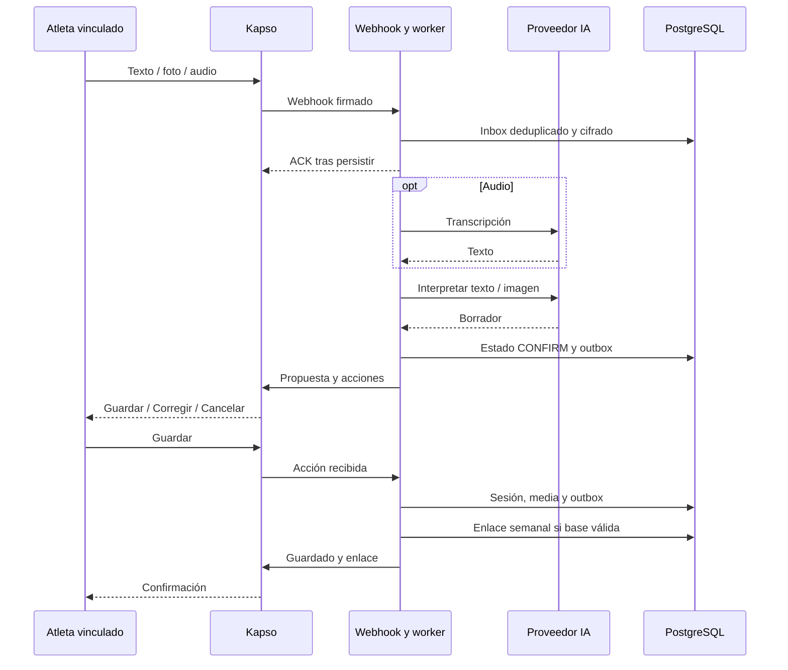
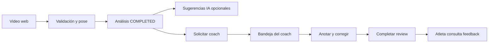

# Recorridos actuales del atleta

Fecha: 2026-10-09. Reconstrucción desde código, suite JS actual y evidencia histórica distinguida en [01](01_FUNCTIONAL_INVENTORY.md). “Disponible” describe el checkout; no certifica una operación remota autenticada. No se probó un teléfono físico en esta auditoría.

## 1. Obtener cuenta e iniciar sesión

**Pasos/pantallas:** hoy el atleta necesita que un coach entre en `/coach/athletes/new`, o que un administrador use `/admin`, cree nombre/usuario/contraseña y le entregue las credenciales por un medio externo. El atleta abre `/login`, escribe usuario y contraseña; POST `/api/auth/login` devuelve destino `/training`. La cookie firmada conserva la sesión.

**Mensajes y acciones manuales:** “Credenciales inválidas” si falla; el coach/admin define y comunica la contraseña. No hay entrega automatizada. El alta admin registra auditoría; el alta coach crea User/Athlete.

**Fricción/errores:** dependencia humana antes del primer entrenamiento; nombres/usuarios duplicados; cuenta desactivada; DB 503; login busca demo_key o nombre, no correo. **No disponible:** autorregistro, recuperación de contraseña, verificación de email, onboarding deportivo, consentimiento coach-atleta explícito. Evidencia: `app/main.py:login/create_coach_athlete`, `app/administration.py`, `tests/test_basic_auth.py`; login/alta coach cubiertos con PostgreSQL actual; UI admin 65/65 JS.

## 2. Vincular WhatsApp

**Pasos/pantallas:** `/training` → panel WhatsApp → generar código explícitamente → abrir WhatsApp mediante enlace `wa.me` o QR → **enviar** `VINCULAR <código>` → esperar respuesta/estado verificado. Abrir el enlace no envía el mensaje. La UI consulta `/api/whatsapp/identity`; permite desvincular con DELETE.

**Mensajes:** “WhatsApp vinculado a Fluxio”; ante fallo pide generar nuevo código. Sin identidad, el bot pide iniciar sesión y generar código. Challenge dura 10 minutos; emisión limitada a tres por hora según `identity.issue`.

**Fricción/errores:** salto entre navegador y chat; número público/configuración/Vault/worker; código vencido, reutilizado o teléfono ligado a otra cuenta; canal deshabilitado 404/configuración 503. En el sandbox, activación del proveedor es distinta de vinculación Fluxio. **No disponible:** vincular automáticamente por perfil o iniciar sesión con WhatsApp. Evidencia: `app/static/whatsapp-link.js`, `app/whatsapp/identity.py/routes.py/runtime.py`, JS actual y H1 histórico; la aprobación humana histórica no especifica QR frente a clic.

## 3. Primer entrenamiento manual

**Pasos/pantallas:** `/training` → Registrar → `/training/new` → descripción → “Completar manualmente” → revisión editable → fecha/título/workout obligatorios → opcionales resultado, adaptaciones, RPE, bloques y videos propios → Guardar → listado/detalle.

**Mensajes/acciones:** completar obligatorios, guardado o error; el atleta redacta el entrenamiento y resultado. La alternativa “Interpretar WOD” llama IA antes de guardar y requiere revisión.

**Fricción/errores:** descripción y ficha son dos etapas; carga/resultado son texto; fecha puede no coincidir con sesión narrada; validación RPE entero 1–10. Error 503/422 conserva el formulario para reintentar dentro de la página; aviso antes de salir. **No disponible:** borrador durable/offline, guardado automático, PR. `training.js`, `training_contracts.py`, `training_service.py`; CRUD PostgreSQL actual y JS con API simulada.

## 4. Entrenamiento mediante fotografía

**Web:** Registrar → Añadir foto de la pizarra → seleccionar/tomar archivo compatible → POST imagen privada → descripción opcional para identificar resultado personal → Interpretar WOD → revisar datos/preguntas → corregir → Guardar. Una foto sola no guarda una sesión.

**WhatsApp:** atleta vinculado envía imagen (caption se incorpora si no hay text.body) → descarga/validación → interpretación → propuesta con fecha y Guardar/Corregir/Cancelar → Guardar → confirmación y enlace semanal cuando PUBLIC_BASE_URL es válido. Si workout está vacío, pide aclaración; preguntas opcionales acompañan propuesta cuando existe workout.

**Fricción/errores:** iluminación, pizarra extensa/borrosa o resultados de terceros; HEIC no aceptado; máximo imagen 8 MB/24 MP y normalización a JPEG/2400 px; fallos de proveedor. La fecha del chat reconoce hoy/ayer y meses españoles escritos, no todo lenguaje temporal. **No disponible:** atribución automática segura de resultado personal entre varios nombres, varias imágenes por ficha. `training_media.py/workout_interpretation.py/kapso.py/capture.py`; H1 registra foto real, pruebas actuales usan fixtures.

## 5. Entrenamiento mediante audio

**Web:** Registrar → Dictar entrenamiento → autorizar micrófono → grabar/detener → POST transcribe → texto añadido a descripción → editar texto → Interpretar WOD o Completar manualmente → revisión → Guardar.

**WhatsApp:** enviar audio → descarga → FFprobe/FFmpeg → transcripción → interpretación → propuesta → Guardar. Nominalmente hay una transcripción y una interpretación; correcciones pueden agregar llamadas.

**Mensajes/acciones:** error de micrófono o transcripción, retry con grabación conservada dentro de la página; el atleta verifica fechas, resultado y carga. Audio ≤8 MB y ≤180 segundos; web requiere contexto seguro y MediaRecorder. **No disponible:** archivo de audio en el historial, transcripción offline, guardado sin confirmación. H1 registra audio OGG/Opus real y corrección de fecha; tests actuales simulan el proveedor pero decodifican fixtures.

## 6. Consultar bitácora

**Pasos/pantallas:** `/training` lista días/sesiones y miniaturas; abrir `/training/{id}` muestra resultado, bloques/workout, adaptaciones, esfuerzo y enlaces de análisis; editar o eliminar desde acciones con confirmación de borrado.

**Mensajes:** estados vacío, carga y recuperación; error de imagen permite fallback. WhatsApp ayuda remite a web; comandos semanales devuelven resumen, no toda la bitácora conversacional.

**Fricción/errores:** máximo 200 sesiones en lista sin paginación/búsqueda; semanas antiguas pueden mostrar entrada sin vínculo al detalle si quedó fuera del listado utilizado para resolver IDs. Texto heterogéneo dificulta filtrar por movimiento. **No disponible:** búsqueda global, gráfico de cargas, PR, consulta natural del historial. `training_service.list_sessions`, `training.js:mountWeek`; PY/JS actuales.

## 7. Revisar resumen semanal

**Pasos/pantallas:** panel en `/training` → expandir → anterior/siguiente/esta semana o elegir fecha → conteo de entrenamientos, días activos y RPE promedio con número de registros → sesiones. En WhatsApp escribir “resumen semana”, “resumen semanal” o “resumen semana pasada”.

**Mensajes/acciones:** semanas vacías no inventan actividad; las estadísticas provienen de sesiones registradas. “Mayor esfuerzo” es RPE subjetivo, no mejor rendimiento. **Fricción:** hay que registrar para que aparezca actividad; no representa entrenamientos no registrados; promedios sin RPE no se rellenan. **No disponible:** envío programado semanal, resumen mensual o recomendación generativa. Semana calendario de Santiago, no período móvil de siete días. `weekly_summary.py`, `capture.py`, PY/JS actuales.

## 8. Compartir resultados

**Web:** panel semana → Crear enlace → aviso de contenido público → copiar URL → pegar manualmente en destino. Permite revocar uno o todos los enlaces de la semana. `GET shares` devuelve id/expiración, sin token/URL anterior; la URL nueva solo se conserva en memoria de la UI.

**WhatsApp:** “compartir semana” genera enlace; “revocar semana” lo desactiva. Actualmente Guardar entrenamiento/nota también intenta crear enlace y agregarlo a la respuesta sin una acción separada de compartir.

**Mensajes/contenido:** aviso: quien tenga enlace ve entrenamientos, resultados, notas/adaptaciones, RPE y fotos; la semana **se actualiza** al agregar/editar/eliminar. Caduca como máximo en 168 h y revocación devuelve 404. Un lector abierto requiere recarga.

**Fricción/riesgo:** URLs anteriores no recuperables tras perder estado UI; exposición de futuras fotos/notas de esa semana y personas de la pizarra; enlace automático del chat reduce elección previa. **No disponible:** audiencia privada, publicación automática en redes, imagen exportable, perfil personal permanente. `weekly.py/weekly_summary.py/training.js/capture.saved_week_link`; PY/JS actual, E2E histórico; no token público remoto creado en auditoría.

## 9. Solicitar análisis técnico y revisión

**Pasos/pantallas:** `/analyses/new` → seleccionar video/ejercicio/vista front o side/objetivo/carga opcional → subir → 202 → seguir progreso → detalle completado → `/analyses/{id}/request-review` → seleccionar coach → confirmar solicitud. El análisis automático y la revisión humana son dos operaciones distintas. También se puede vincular el análisis propio en una sesión.

**Mensajes/acciones:** fallos de validación/tamaño/pose/ejercicio; procesamiento/FAILED; “espera” mientras no esté COMPLETED; solicitud activa bloquea duplicados. El atleta debe grabar un ángulo útil y escoger ejercicio/vista. Cuota consumida al iniciar la operación, incluso si falla después.

**Fricción/errores:** upload y cómputo pesado, cobertura limitada por perfil, detecciones corregibles; reinicio marca análisis pendiente como FAILED. **No disponible:** iniciar biomecánica a partir del video recibido por WhatsApp, revisión mensual incluida contractualmente o garantía de entrega del coach. `main.py`, `analyzer.py`, `exercise_validation.py`, `athlete-state.js`; H2 y tests actuales con alcance detallado en 03.

## 10. Recibir observaciones del entrenador

**Coach:** `/coach/reviews` → solicitud → `/coach/reviews/{id}` → iniciar → reproducir/seek → anotar timestamp → confirmar/descartar sugerencias IA → corregir repeticiones → elegir mejor/por trabajar → fortalezas, foco principal y próxima sesión → guardar → completar.

**Atleta:** vuelve a listado/detalle de análisis → observa disponibilidad de revisión → feedback completado y anotaciones temporales. “Mejor repetición” es juicio de esa revisión, no récord personal.

**Fricción/errores:** depende de trabajo humano y retorno manual a la app; requiere main_focus/next_session y completed_at; review completada bloquea cambios; errores al guardar conservan estado en la UI. **No disponible:** push/email/WhatsApp automático de feedback, chat bidireccional, SLA o seguimiento de cumplimiento de recomendaciones. `main.py`, `app.js/review-state.js`; JS actual, H2 histórico, suite backend en 03.

## Diagramas de los flujos reales

## Evaluación UX móvil acotada

Evidencia actual: pruebas de compositor, 320–430 px, estados vacíos/error, teclado y reduced-motion en `training-ux.test.cjs`; roles/nav en `mobile-navigation.test.cjs`; enlace/desvinculación en `whatsapp-link.test.cjs`. CSS incorpora safe-area, controles de 44 px y fuentes de formulario de 16 px; `mobile-ux.js` reacciona a visualViewport. Estos hechos no certifican WCAG ni hardware real.

| Dimensión | Evaluación provisional /4 | Límite de la conclusión |
| --- | --- | --- |
| Accesibilidad | 3 | Labels, status, foco/dialog y teclado cubiertos en pruebas; contraste completo y lector de pantalla no verificados |
| Performance | No verificado | Fuentes locales, lazy loading y JS sin framework; sin medición de dispositivo/red real |
| Responsive | 3 | Pruebas de viewport pasan; cámara/teclado/safe-area físicos actuales no verificados |
| Theming | 2 | Tokens en visual-v2.css, también colores literales; sin preferencia dark mode implementada |
| Integridad | 3 | Registro y recap siguen datos guardados; naming WOD y promesas comerciales necesitan precisión |

No se calcula puntaje total con dimensión no verificada. No se ejecutó detector visual ni se modificó UI; auditoría funcional prevalece sobre sugerencias de pulido de la skill.

Hallazgos priorizados: **P1 onboarding bloqueado por alta humana** (main.py; proponer autorregistro/piloto asistido), **P1 menú Agregar nota pierde intención** (capture.py; instrucción clara o estado de nota), **P1 compartir automáticamente tras Guardar** (capture.saved_week_link; separar elección de compartir), **P2 historia >200 sin paginar** (training_service.py/training.js), **P2 URL anterior no recuperable** (weekly_summary.list_shares/training.js). No son fallos de contraste inventados; su impacto se deduce del flujo. Antes de lanzamiento validar contraste, lector de pantalla y teléfono físico. Para una futura intervención de UI: `$impeccable onboard`, `$impeccable clarify`, `$impeccable harden`, y finalmente `$impeccable polish`; no se ejecutan en esta auditoría.

