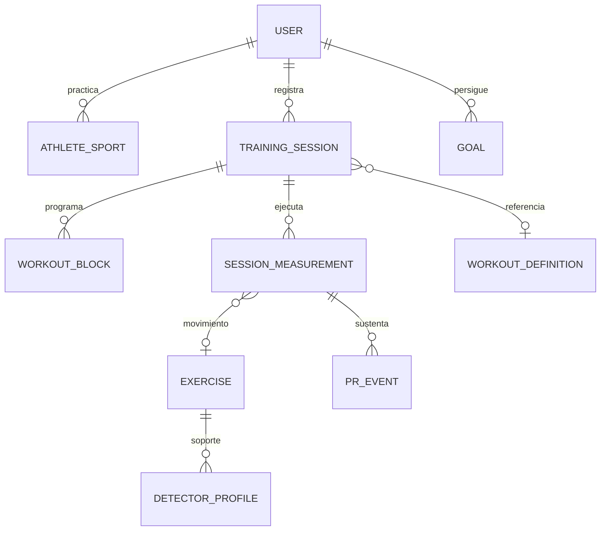

# Preparación multidisciplina

Fecha: 2026-10-09. **Hecho:** el modelo puede almacenar descripción libre de distintos deportes; **inferencia:** no puede medir ni comparar rigurosamente su evolución con el contrato actual. La arquitectura compartida HTTP/WhatsApp se puede conservar. Ningún cambio propuesto se implementa.

## Revisión del modelo actual

| Aspecto solicitado | Estado verificable | Consecuencia |
| --- | --- | --- |
| TrainingSession | id, atleta, trained_on, title, source_text, workout, result_text, adaptations, RPE, video_links, blocks, source_image_id, athlete_notes, created_at | Buen agregado de diario, sin sport/disciplina, duración estructurada ni ejecución tipada |
| Catálogo | 20 ejercicios orientados CrossFit; categorías, referencias y detector_profiles | Reutilizable como catálogo inicial; no catálogo de deportes, rutas o equipos |
| Identidad del movimiento | Movement.name y prescription libres | No unión con exercise_id; alias/variantes no seguros para PR |
| Unidades | Prompt conserva unidades originales; Analysis.load_kg numérico; RPE entero | Cargas del WOD pueden ser kg/lb en texto; no conversión/dimensión general |
| Series/reps/carga/tiempo | WorkoutBlock.format strength/for_time/amrap/emom/other; prescription textual | Describe programación, no registra cada serie ejecutada ni score comparable |
| Distancia/ritmo | Pueden figurar en texto | No distance_m, duration_s, pace ni velocidad tipados |
| Métricas por disciplina | Repetition.metrics para biomecánica de video | No métricas de sesión running/ciclismo/fuerza como volumen/potencia/desnivel |
| Objetivos deportivos | Analysis.objective textual | Objetivo de un video, sin meta/fecha/progreso |
| Comparación | Comparaciones internas de métricas en ai_reasoning.build_input | No identidad/versionado ni comparador longitudinal de WOD |
| Dependencia WOD | Naming/prompts/formatos en interpretación, regex chat y badges UI | Afecta entrada, extracción, taxonomía y visualización, no toda la infraestructura |
| Varias disciplinas por atleta | No restricciones deportivas en User/Athlete; tampoco colección de disciplinas | Puede narrarlas, no clasificarlas ni configurar métricas/preferencias |
| Calendario | trained_on Date y semana Santiago | Sirve para varias sesiones diarias; no instantes/timezone por usuario ni planificación |

Fuentes: `app/models.py:TrainingSession/Analysis/Repetition/Athlete`, `services/training_contracts.py`, `workout_interpretation.py:Movement/WorkoutBlock`, `exercise_library/*.json`, `whatsapp/capture.py`, `weekly_summary.py`, `static/training.js`.

## Propuesta compatible, incremental

### 1. Enriquecer sin reemplazar

Agregar de forma aditiva y opcional sport_id/session_type y schema_version al entrenamiento; conservar campos actuales y lectura de registros legacy. Crear AthleteSport para varias disciplinas y preferencias por usuario. No asignar CrossFit a toda la historia silenciosamente: valores unknown/legacy con clasificación explícita o revisión del atleta.

Separar **programación** de **ejecución**. WorkoutBlock y su texto original siguen disponibles; un conjunto de SessionMeasurement/PerformedSet conserva lo ejecutado: exercise_id opcional, variante, series/reps/carga/unidad original, duración, distancia, rondas/reps extra, estado terminado/abandonado y Rx/scaled cuando fue declarado. Campos unknown permanecen nulos, nunca cero ni datos inventados.

### 2. Métricas tipadas y unidades

Proponer contrato Measurement con metric_key, value, unit, provenance (manual/AI/import), source_ref, confidence opcional y confirmed_by/confirmed_at. Validar dimensión y rangos; convertir a unidad canónica conservando valor original. Fuerza: kg y reps; running: m, s, desnivel m; ciclismo posterior: m, s, watts, elevación; RPE común. El ritmo se deriva de distancia y tiempo válidos, no de texto interpretado a ciegas.

JSONB puede alojar extensiones por deporte con schema_version validado; métricas usadas para consultar/comparar deben ser indexables y tener contrato tipado. No colocar todo el dominio en un JSON libre no validado. Mantener adaptación/carga de video sin cambiar el contrato del analizador.

### 3. Catálogo y equivalencia

Extender ExerciseLibrary con IDs estables, alias idiomáticos, variante y disciplinas compatibles. Un ejercicio puede pertenecer a varios deportes. DetectorProfile queda separado: support_counting, support_findings, vistas y limitaciones no se deducen de presencia en catálogo.

Resolver nombres a IDs con posibilidad de movimiento custom; toda resolución dudosa requiere revisión. No agrupar power/full clean ni back/front squat para PR. Catálogo existente y alias de preflight son insumos, no identidad universal.

### 4. Resultados comparables

Crear WorkoutDefinition con versión/programación canónica; SessionResult tipado con score_type, value/unit, time_cap, finished, rx/scaled y adaptation_signature. Comparar solo definiciones y condiciones equivalentes. Dos “Fran” nominales sin programación/carga explícita no deben considerarse comparables; el prompt actual correctamente no inventa benchmark por nombre.

PR requiere política versionada por métrica: mayor carga para misma variante/serie/reps; menor tiempo en workout completo equivalente; mayor rondas+reps en mismo AMRAP. Un score incompleto o carga desconocida no participa. Dejar “marca posible” para información insuficiente.

### 5. Objetivos y resumen

Agregar Goal (métrica, deporte/movimiento, baseline, target, deadline, status). Estadísticas semanales existentes se reutilizan; agregación mensual/progreso consulta medidas confirmadas, informa muestra y mantiene acceso a evidencia. IA redacta sobre aggregates autorizados; no produce hechos nuevos.

Diagrama **propuesto**, no esquema SQL actual. Conservar TrainingSession/Analysis/Repetition/CoachReview y contratos existentes, agregando conexiones opcionales.

## Transición y validación

1. Contratos aditivos aceptan payload legacy sin campos nuevos; no cambiar rutas ni transporte WhatsApp.
2. Datos nuevos usan schema_version; lectura dual para antiguo/nuevo.
3. Interpretador devuelve medidas propuestas con texto fuente y dudas; atleta confirma sin forzar una segunda ficha extensa.
4. Backfill es opt-in/revisado; extracción histórica no sobrescribe texto ni produce PR confirmado sin evidencia.
5. Probar contrato antiguo, owner/roles, fechas, semanas/share actuales, unidad kg/lb y nulos, comparación Rx/scaled, propiedad por deporte, corrección/eliminación invalidando PR derivado y video sin cambios.
6. Índices según consultas reales; no particionar ni separar microservicios prematuramente.

Orden sugerido: fuerza + score CrossFit básico → progreso/PR verificables → running manual con distancia/tiempo → importación de dispositivos. No empezar por ciclismo/potencia sin demanda observada.

## Preparación concreta por deporte

| Deporte | Puede usar hoy | Falta para soporte auténtico |
| --- | --- | --- |
| CrossFit | WOD textual, bloques, RPE, foto/voz, video de movimientos cubiertos, coach | Score/variantes/Rx tipados, identidad de WOD, PR/evolución |
| Musculación | Diario, bloque strength, carga textual y algunos análisis de ejercicio | Sets ejecutados, repeticiones/carga por set, descanso, catálogo ampliado, volumen y progresión |
| Running | Narración libre de carrera y RPE | Distancia/duración/ritmo estructurados, terreno/desnivel, PR por distancia y comparación de contexto |
| Ciclismo | Narración libre | Distancia/duración/potencia/desnivel, equipo, zonas y autorización de integración |

**Inferencia:** la extensibilidad del backend es favorable por el servicio compartido y JSONB, mientras el modelo de rendimiento necesita evolución considerable. Etiquetar un registro como running no basta para afirmar que running está soportado.

