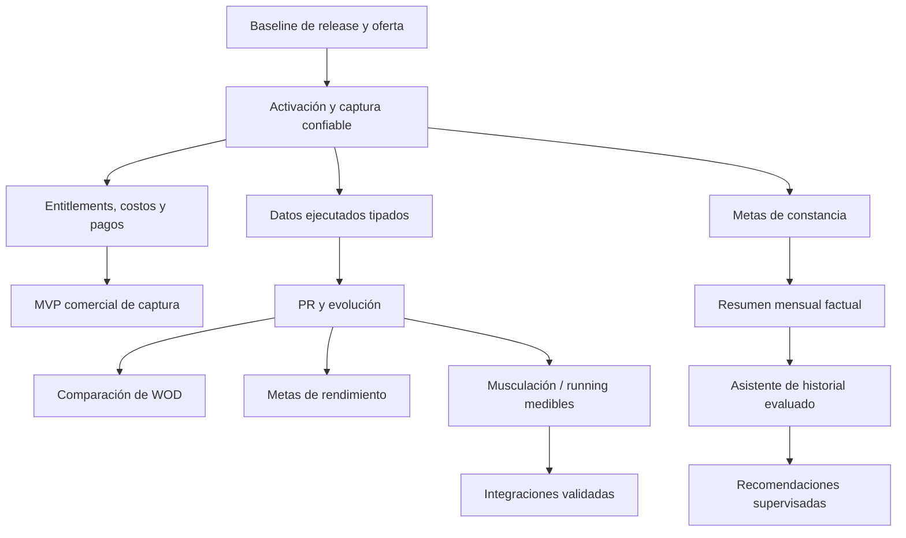

# Propuesta de roadmap de producto

Fecha: 2026-10-09. **Propuesta**, no compromiso de implementación, calendario, demanda ni ingresos. Priorización combina visión del producto, dependencias verificadas y riesgos antes de cobrar; impacto/valor son hipótesis evaluadas en [05](05_PRODUCT_GAPS.md). Trabajar una fase a la vez, conservar arquitectura/contratos y no duplicar componentes.

## Cinco mejoras de mayor impacto propuesto

1. **Activación confiable:** alta/recuperación y onboarding mínimo, permisos coach-atleta y cuenta activa consistente en web/chat.
2. **Captura más corta y segura:** intención de nota, fecha/correcciones, una confirmación clara, separar Guardar de Compartir y fallback manual. Reutilizar OCR/voz/WhatsApp existentes.
3. **Datos comparables + progreso/PR:** distinguir programación/ejecución, ejercicio/variante/unidades/score y mostrar solo marcas fundamentadas.
4. **Pro cobrable y sostenible:** entitlement/quotas transversal, accounting por sesión, pagos/conciliación y límites claros con costos observados.
5. **Retorno recurrente al historial:** metas de constancia y resumen mensual factual antes de asistente/recomendaciones; medir utilidad.

Son mejoras de producto, no cinco features ya desarrolladas. La 4 es gate comercial aunque no siempre se perciba como beneficio visual.

## Fase 0 — Baseline y contrato de lanzamiento

**Objetivo:** saber exactamente qué se publica y cuál es la oferta. **Reutilizar:** migraciones, tests actuales y health/OpenAPI. **Trabajo propuesto:** separar cambios locales por alcance, incluir administración 0022 si corresponde, release con pruebas/gate y versión observable; definir manual/IA/video/coach y sharing. No inferir paridad por /api/health ready.

**Criterios de salida:** commit/imagen/migración del destino identificados; routes y assets compatibles; smoke autenticado en entorno autorizado; no secretos demo previsibles; backups y restauración verificados. Baseline actual 479 Python aprobadas + 1 omitida y 65 JS sirve de punto de partida, no prueba del destino.

**Dependencias/riesgos:** workspace sucio y features no publicadas; no hacer merge/deploy de todo por conveniencia. Esta auditoría no realiza publicación.

## Fase 1 — Captura y activación como núcleo

**Objetivo:** completar primer entrenamiento con poco esfuerzo y conservar confianza.

**Construir sobre:** TrainingService, compositor, transcripción, interpretación, identidad/chat, rutas de diario. Corregir intención del botón nota, fechas comunes con presentación visible, paginar historia y recuperación de datos. Definir consentimiento de compartir; creación de enlace solo mediante acción explícita. Añadir alta/recovery si se abre autoservicio; piloto asistido puede seguir con invitación bien comunicada. Validar is_active en canal chat y permisos de coach.

**Criterios de salida:** atleta objetivo puede activar y completar una sesión por canal elegido sin ayuda imprevista; foto/audio conservan resultado/fecha tras corrección; no persiste sesión sin confirmación vigente; no comparte sin elección; error/reintento no duplica; cuenta desactivada bloqueada en todos los canales; datos/fotos de terceros no accesibles.

**Medición:** tiempo hasta primer registro, turnos y llamadas por sesión, porcentaje de correcciones, éxito/fallo por canal, abandono de vinculación. Establecer umbrales con baseline real antes del experimento.

## Fase 2 — MVP comercial Free/Pro de captura

**Objetivo:** cobrar por una capacidad real con costo y acceso controlables. No esperar a un asistente de historial general.

**Construir sobre:** AdminSetting, PlanInteraction, TrainingAIUsage/AIReasoningRun/WhatsAppUsage y UI admin. Entitlements/ledger idempotente en servicio compartido, reglas de fallos/reembolso, contador por sesión/operación y permisos por canal. Integrar suscripción en sandbox, beneficio fundador explícito, cancelación/downgrade y conciliación. Medir costos y ofrecer cuotas claras.

**Oferta propuesta:** Free diario manual + estadísticas/semanal; Pro captura texto/foto/audio con presupuesto medido. WhatsApp bajo política confirmada. Precio normal/fundador son hipótesis del usuario, no garantía de margen. Historial inteligente no anunciado. Video/coach solo en piloto separado hasta validar soporte y disponibilidad.

**Criterios de salida:** pago sandbox activa una sola vez; replay webhook no duplica derechos; cancelación/downgrade conserva historial; límites coherentes web/chat/coach; un resultado incierto no cobra/reintenta ciegamente; costo monetario conciliable; alertas y soporte definidos.

**Gate:** no comenzar cobro real si falta entitlement de WhatsApp, pago/cancelación, consentimiento o entrega prometida. Ver [06](06_FREE_PRO_READINESS.md).

## Fase 3 — Progreso verificable CrossFit/fuerza

**Objetivo:** aportar la mitad de la visión que falta: evolución basada en historial.

**Construir sobre:** catálogo, bloques, sesiones/fechas e imágenes fuente. Agregar measures/sets/result/variant/unit y provenance confirmada, WorkoutDefinition cuando haya repetición comparable, reglas PR/version y dashboard de evolución. Empezar con pocas métricas bien definidas y no convertir todo el histórico automáticamente.

**Criterios de salida:** no mezcla programación con ejecución, kg/lb ni variantes; marca enlaza evidencia; corregir/eliminar recalcula; entrenamiento incompleto/Rx-scaled no produce falso PR; payload legacy y análisis de video funcionan; atleta comprende “sin datos suficientes”.

**Medición:** uso de progreso, errores de clasificación/unidad, confianza declarada, retorno a revisar marcas, completitud de medidas. Dependencias: fase 1 y modelo 04, no un nuevo pipeline OCR.

## Fase 4 — Metas y recap mensual

**Objetivo:** convertir registro en hábito/reflexión útil.

**Construir sobre:** WeeklySummaryService, recap y permisos. Objetivo de constancia primero, metas de rendimiento después de fase 3. Mes actual/anterior, muestra de RPE y datos faltantes; narrativa IA opcional apoyada en aggregates, con cache por versión/periodo y evidencia.

**Criterios de salida:** distingue sesiones registradas de actividad real, ninguna recomendación o PR inventado, privacidad igual que semanal, costos de regeneración controlados, usuario puede entender/desactivar meta/share. No programar mensajes proactivos sin opt-in.

## Fase 5 — Expansión controlada y asistente

**Objetivo:** probar demanda antes de ampliar superficie/costos.

- Musculación: sets, cargas por serie y catálogo; reutilizar perfiles compatibles.
- Running: entrada distancia/tiempo/ritmo y contexto manual; integraciones solo después de confirmar proveedores usados.
- Asistente: preguntas de lectura estructuradas con fechas/evidencia y aislamiento; no acceso libre a toda la DB.
- Preparación/recomendaciones: experimentos con coach experto, no entrenador autónomo.
- Video: expandir soporte después de validar por ejercicio/vista, dataset real y capacidad operativa. Durable jobs cuando el SLA lo necesite.

**Criterios de salida:** cada subfase tiene cohortes/casos definidos, esquema validado, costo medido y contrato de soporte; autorización OAuth/importación, idempotencia y revocación si se integra un dispositivo. No anunciar simultáneamente múltiples deportes solo porque aceptan texto.

## Secuencia y dependencias

Las ramas muestran dependencias, no instrucción de ejecutar agentes en paralelo. El trabajo se organiza una fase a la vez.

## Qué posponer y qué conservar

Posponer desafíos/red social, prescripción IA autónoma, dispositivos antes de schema/demanda, expansión amplia de detectores y auto-confirmación general. Son hipótesis de valor aún sin validación que aumentan superficie/operación.

Conservar TrainingSession y sus rutas, TrainingService compartido, UI de captura/review, estado WhatsApp/dedupe/outbox, WeeklySummaryService/sharing con permisos, ExerciseLibrary y pipeline video/coaches. No recrear OCR, transcripción, catálogo, resumen semanal, inbox de coach o administración: ya existen.

## Decisión de inversión

Si piloto muestra captura frecuente pero poco retorno al recap, priorizar PR/trends sobre más contenido social. Si hay muchas correcciones y costo por sesión alto, mejorar entrada/fecha/propuestas antes de añadir recomendaciones. Si video aporta valor pero coach consume demasiada capacidad, ajustar oferta/cupo sin prometer automatización de juicio humano. Son decisiones propuestas basadas en métricas por levantar; no conclusiones de demanda ya observada.

